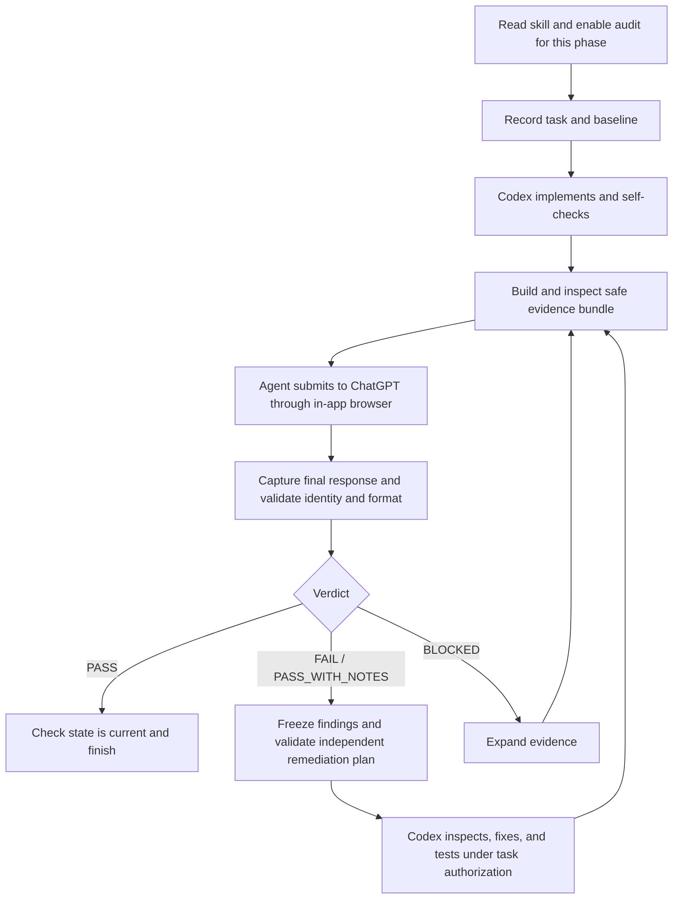

# Post-task Audit Gate

Agent-run, evidence-based review of completed work with an independent ChatGPT auditor.

[简体中文](README.zh-CN.md) · [Workflow](SKILL.md) · [Real example](examples/evidence-expansion/README.md)

Created by **[X1IZHU](https://github.com/X1IZHU)** with assistance from Codex. [MIT licensed](LICENSE).

An AI coding agent saying “done” does not establish that the requirements, execution
paths, and test evidence agree. This skill has Codex finish implementation and local
checks, then package the task, relevant source, changes, and verification records for
a separate ChatGPT conversation to review. Codex supplies evidence or fixes;
the auditor independently verifies the result.

Once enabled for a phase, the agent handles packaging, browser submission, response
capture, and follow-up rounds. You do not have to drive each audit step yourself.
This is a community project, unaffiliated with and not endorsed or sponsored by
OpenAI. The installation and invocation identifier remains `post-task-chatgpt-audit`.

## Features

- **Autonomous post-task workflow:** runs after an opted-in phase is implemented and self-checked.
- **Evidence-based review:** treats implementation reports as claims; requests missing material evidence.
- **Task identity binding:** fingerprints the task, worktree, project context, and evidence manifest.
- **Structured results:** returns verdicts, stable finding IDs, evidence requests, and remediation guidance.
- **Independent closure:** Codex can fix or dispute findings; the auditor decides whether they are closed.
- **Fail-closed checks:** wrong identities, stale state, pending attachments, and invalid responses cannot satisfy completion.

An existing Xiaohongshu user-panel review profile is also included; see [SKILL.md](SKILL.md).
Its success means ready for user review, never permission to publish.

## How it works



Strict auditing defaults to three rounds, with a separate evidence-expansion budget.
Unavailable browser capabilities, real user decisions, permission restrictions, and
exhausted budgets are reported explicitly. [Protocol summary](docs/PROTOCOL.md)

## Installation

Use a Codex desktop environment with the in-app browser and Computer Use, plus
Python 3.12. Sign in to your own ChatGPT account in the browser and allow the local
file operations needed for the task.

**Recommended:** download this repository using **Code → Download ZIP**, extract it,
and open a terminal in the directory containing this README. An existing checkout
works too. Run:

```sh
python3 -B scripts/install.py
```

The destination is `~/.agents/skills/post-task-chatgpt-audit`. The installer copies
runtime resources, documentation, examples, and license notices. It installs no dependencies,
changes no Codex configuration, and refuses to overwrite an existing destination.
Preserve your old installation before upgrading, or choose a separate destination.

For example, install into a project's skill directory from this repository root:

```sh
python3 -B scripts/install.py --target /path/to/your-project/.agents/skills/post-task-chatgpt-audit
```

Replace `/path/to/your-project` with the actual project path. Avoid duplicate
installations with the same skill name, which can make selection ambiguous.

**Manual:** create `post-task-chatgpt-audit` inside `~/.agents/skills/` and copy
`SKILL.md`, `EVIDENCE_POLICY.md`, `scripts/`, `templates/`, `schema/`,
`docs/`, `examples/`, `LICENSE`, `NOTICE`, and both
READMEs into it. Do not merge over an old installation. Restart Codex if the skill
does not appear. See the [official skill documentation](https://learn.chatgpt.com/docs/build-skills)
for discovery locations and invocation.

## Quick start

In the project you want to work on, send Codex this prompt, replacing the example task:

```text
Use $post-task-chatgpt-audit. Add a health-check endpoint and appropriate tests to this project.
I opt into an independent ChatGPT audit after this whole phase is implemented and self-verified.
You may upload task-relevant evidence after checking it contains no sensitive information.
Handle packaging, browser submission, response capture, any needed remediation, and re-audit
autonomously, within the default round limits.
```

This prompt is an **illustration**, not a recorded execution. A real historical case
appears below.

The agent reads the skill, saves the original task and baseline, completes the task,
then runs the audit and returns a concise summary with the local response path.
You do not normally invoke helper scripts or upload files manually. Late invocation
is supported, but the skill must disclose the limits of a late baseline.

Each response is saved inside the project being audited:

```text
.codex-audit/sessions/<task_id>/round-<NN>/AUDIT_RESPONSE.md
```

Initial sign-in, permission grants, and genuine product or design decisions may need
your input. Audit-provided commands do not acquire execution authority: the current
protocol has no trusted execution-environment attestation, so all such unattested
commands are ineligible for `READY`; `NO_SAFE_COMMAND` is a valid stopped pack.
Codex may still inspect, edit, and run independently reviewed local tests under the
original task authorization and host permissions. It must record that distinction
and respect actual stop conditions.

## Real example: evidence expansion before PASS

In a local Web/API regression task, the implementer had run checks and reported
success. Round 1 independently returned `BLOCKED`: the original browser execution
records, database migration transcript, and a cited historical audit were missing.
Codex supplied that evidence. Round 2 returned `PASS`, limited to the local task scope.

The [case study and sanitized excerpts](examples/evidence-expansion/README.md) include
actual response extracts, source digests, and reproduction guidance. This is
historical evidence, not a new audit of this release candidate. Included unit tests
verify local mechanisms; passing them is not a browser audit.

## Audit results

| Verdict | Meaning and next action |
|---|---|
| `PASS` | Evidence is sufficient for scope, requirements are met, and no material finding remains. Identity, transport, and current-state checks must also pass before completion. |
| `PASS_WITH_NOTES` | Does not close the default gate. Review/remediate, or ask the auditor to normalize non-actionable notes to PASS. |
| `FAIL` | Actionable findings remain. Validate the independent remediation plan, fix, and re-audit. |
| `BLOCKED` | Evidence is insufficient to decide. Expand evidence before changing implementation merely because of this verdict. |

Malformed responses and `AUDIT_RESULT=STALE` are local validation states, not extra
audit verdicts. Exhausted budgets produce an unresolved result; stopping or skipping
is never reported as passing.

## Requirements and verified scope

| Component | Requirement / evidence boundary |
|---|---|
| Agent | Existing workflow targets Codex desktop. Other agents have not been validated end to end. |
| Browser | Codex in-app browser + Computer Use, ZIP upload and response capture, authenticated ChatGPT session. |
| Python | Checks for this candidate ran on macOS with Python 3.12.3. Helpers use only the standard library; other Python versions were not tested here. |
| Git | Recommended for baseline/diff evidence. Missing Git evidence must be disclosed. |
| Windows / Linux | Platform branches exist, but installation and the complete browser workflow were not tested here; no end-to-end compatibility claim. |
| External services | ChatGPT account, network, and available file-upload capability. The helpers themselves require no API key. |

There is no silent fallback to a system browser. An external browser requires
explicit approval and a recorded reason. Clipboard fallback, when eligible, uses
`pbpaste`, PowerShell, `wl-paste`, or `xclip`; these fallback tools are not required
for normal artifact downloads.

## Security and privacy

The agent reads relevant project files, task text, diffs, test outputs, and optional
project context, builds a local evidence bundle, and uploads it to ChatGPT. Bundles
can contain source and paths; the repository census can reveal sensitive filenames.
The sensitive-path policy excludes common secret files but is not a complete secret
scanner. Inspect source, reports, and logs for embedded sensitive values before upload.

This repository ignores `.codex-audit/`; initialization also attempts to exclude it
locally in other Git projects. Local files remain on your machine. Uploaded evidence
is subject to your ChatGPT account's service and data settings. Never attach a full
private bundle to a public issue. Hashes and protocol checks strengthen consistency;
they cannot guarantee correct code, an infallible auditor, or non-malicious evidence.

## License and feedback

Licensed under [MIT](LICENSE), which permits use, modification, sharing, and commercial
use while requiring retention of its copyright and permission notice in copies or
substantial portions. Original author: **X1IZHU**. See [NOTICE](NOTICE).

Use this repository's **Issues → New issue → Bug report** for problems and suggestions.
Include your environment, a minimal reproduction, and redacted error output.
To run the existing local tests from the downloaded source repository root:

```sh
python3 -B -m unittest discover -s tests -v
```

Project map: `SKILL.md` is the agent entry point; `scripts/` contains local helpers;
`templates/` contains audit controls; `schema/` describes data shapes;
`docs/PROTOCOL.md` explains the protocol; `tests/` covers local mechanisms.
See the [release validation record](docs/VALIDATION.md).
