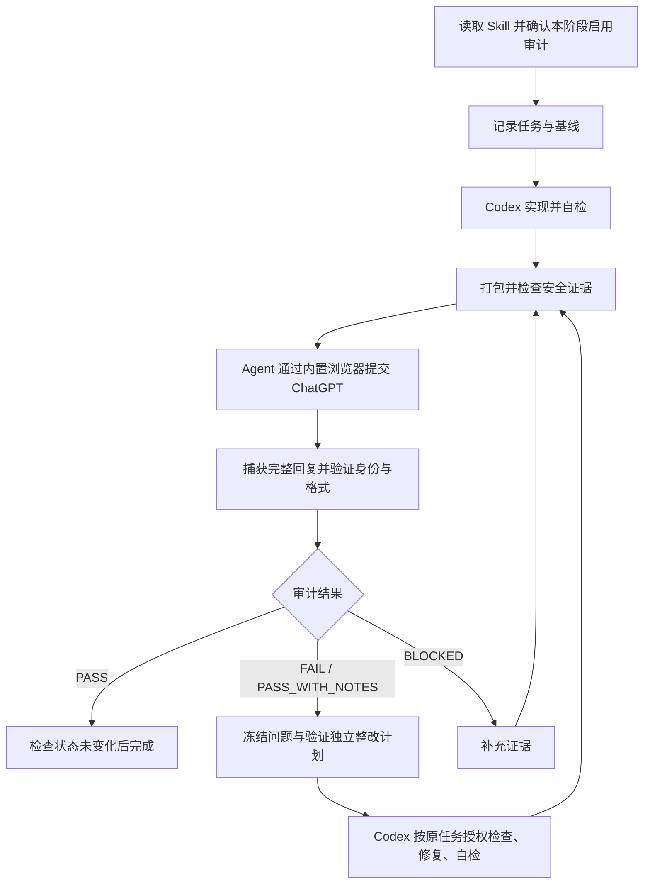

# Post-task Audit Gate

当前版本：**v0.2.0**。[更新内容](CHANGELOG.md) · [验证记录](docs/VALIDATION-v0.2.0.md)。

让 Agent 完成任务后，自动组织一次基于证据的独立 ChatGPT 审计。

[English](README.md) · [完整工作流](SKILL.md) · [真实案例](examples/evidence-expansion/README.md)

作者：**[X1IZHU](https://github.com/X1IZHU)**，使用 Codex 辅助开发。[MIT 许可](LICENSE)。

AI 编程 Agent 说“完成了”，并不代表需求、实际执行路径和测试证据都吻合。
这个 Skill 让 Codex 先完成实现和自检，再把任务、相关源码、变更和验证记录
整理成证据包，由独立的 ChatGPT 对话检查。Codex 负责补充证据或修复，审计方
负责复核。用户无需手动创建证据包、上传每一轮材料或复制审计结果。

这是社区项目，与 OpenAI 无隶属、赞助或官方认可关系。
安装与调用标识保留为 `post-task-chatgpt-audit`。

## 主要能力

- **Agent 自主组织审计：** 用户选择启用后，在完整阶段实现和自检结束时运行。
- **依据材料核验：** 实现报告被当作待核实的说法；缺少关键证据时要求补充。
- **绑定审计对象：** 任务、当前文件状态、项目上下文和证据清单共同生成对象标识。
- **结构化结果：** 返回明确判定、稳定问题编号、证据请求和整改指导。
- **独立复核：** Codex 可以修复或提供反证，不能自行关闭审计问题。
- **保守失败处理：** 错误身份、过期状态、未就绪附件或不合格回复不能通过完成门槛。

## 工作过程



严格审计默认最多 3 轮，证据扩展另有预算。浏览器不可用、需要真实用户决定、
权限受限或达到预算时，会明确报告停止原因。[协议摘要](docs/PROTOCOL.md)

## 安装

需要具备内置浏览器和 Computer Use 的 Codex 桌面环境，以及 Python 3.12。
在浏览器中登录自己的 ChatGPT 账号，并允许该任务所需的本地文件操作。

**推荐：** 从本仓库的 **Code → Download ZIP** 下载并解压，或使用已有本地检出。
在包含本 README 的目录中运行：

```sh
python3 -B scripts/install.py
```

安装到 `~/.agents/skills/post-task-chatgpt-audit`。安装器复制运行所需资源、
说明、示例和许可文件，不安装依赖、不更改 Codex 配置、不覆盖已有目录。
已有同名安装时会停止。升级前自行保留旧版本；需要并存时为安装器指定新路径。

例如，项目级安装可在仓库根目录运行：

```sh
python3 -B scripts/install.py --target /path/to/your-project/.agents/skills/post-task-chatgpt-audit
```

这里的 `/path/to/your-project` 必须换成实际项目路径。不要同时安装多份同名 Skill，
以免选择时混淆。

**手动安装：** 在 `~/.agents/skills/` 中新建 `post-task-chatgpt-audit` 目录，
复制 `SKILL.md`、`EVIDENCE_POLICY.md`、`scripts/`、`templates/`、`schema/`、
`docs/`、`examples/`、`LICENSE`、`NOTICE` 和两个 README。
不要合并覆盖旧安装。调用列表未更新时重启 Codex。
路径与加载方式参考 [官方 Skill 文档](https://learn.chatgpt.com/docs/build-skills)。

## 快速开始

在需要完成任务的项目中，给 Codex 发送下面这条消息；把示例任务换成你的任务：

```text
使用 $post-task-chatgpt-audit。为这个项目增加一个健康检查接口及相应测试。
我选择在这个完整阶段实现和自检结束后运行独立 ChatGPT 审计。
允许上传本任务相关且已检查不含敏感信息的证据。
请自主完成打包、浏览器提交、结果捕获、必要整改和复核；遵守默认轮次限制。
```

这是一条**使用示意**，不是已执行案例。真实历史案例见下节。

Agent 会读取 Skill、保存原始任务和基线，完成任务后自主发起审计，并返回摘要和
本地结果路径。正常情况下你无需调用辅助脚本或手动上传文件。
`SKILL.md` 也允许在结束时才启用，但此时必须标记基线建立较晚的局限。

每轮结果保存在目标项目内：

```text
.codex-audit/sessions/<task_id>/round-<NN>/AUDIT_RESPONSE.md
```

首次浏览器登录、权限授权以及真正的产品或设计决定，仍需用户处理。
报告中给出的命令不会直接获得执行授权：当前协议没有可信运行环境证明，
所有此类未证明命令均不能成为 `READY`，有效停止状态是 `NO_SAFE_COMMAND`。
Codex 仍可依据原任务授权和宿主权限，自主检查、编辑和运行经自己检查的本地测试，
但必须区分这两种授权来源，并遵守实际停止条件。

## 真实案例：补充证据后通过

一次本地 Web/API 回归任务中，实现方已运行检查并报告成功。独立审计第一轮返回
`BLOCKED`：缺少原始浏览器执行材料、数据库迁移记录以及被引用的历史审计原文。
Codex 补充了这些证据。第二轮审计返回 `PASS`，并明确限制为本地任务范围。

[完整案例说明与脱敏节选](examples/evidence-expansion/README.md) 包含真实回复的
摘录、来源摘要哈希和复现方法。它是历史记录，不是对本发布候选的新审计。
附带单元测试验证的是本地机制，不等同于完成浏览器审计。

## 如何理解结果

| 结果 | 含义与后续动作 |
|---|---|
| `PASS` | 当前范围证据充分，需求满足，无未解决的实质问题；还需身份、传输和状态一致性检查才能完成。 |
| `PASS_WITH_NOTES` | 默认不能完成。检查说明并整改，或请审计方复核规范为 PASS。 |
| `FAIL` | 存在待处理的问题，先验证独立整改计划，再修复并复核。 |
| `BLOCKED` | 材料不足以判断，先补充证据；不因这个结果直接修改业务代码。 |

回复不合格和 `AUDIT_RESULT=STALE` 属于本地校验状态，不是额外的审计判定。
达到预算后会明确报告未解决状态，不会把停止或跳过写成通过。

## 环境要求和验证范围

| 项目 | 要求 / 证据边界 |
|---|---|
| Agent | 现有工作流面向 Codex 桌面环境；未验证其他 Agent 的完整兼容性。 |
| 浏览器 | Codex 内置浏览器 + Computer Use，能上传 ZIP 并捕获回复；ChatGPT 需已登录。 |
| Python | 本候选在 macOS、Python 3.12.3 上执行检查；辅助程序仅依赖标准库。其他版本未在本次验证。 |
| Git | 推荐安装以保存基线和变更；不可用时需披露证据局限。 |
| Windows / Linux | 有跨平台代码分支，但本次没有完整安装与浏览器链路测试，不承诺端到端支持。 |
| 外部服务 | 需要 ChatGPT 账号、网络及可用的文件上传能力；辅助程序本身不需要 API Key。 |

默认不会退回系统浏览器；外部浏览器需要明确授权并记录原因。
剪贴板捕获是有限条件下的备用方式，依操作系统调用 `pbpaste`、PowerShell、
`wl-paste` 或 `xclip`；不必为正常下载路径安装这些备用工具。

## 安全与隐私

Agent 会读取项目相关文件、任务说明、变更、测试输出和可选项目上下文，生成本地
证据包，再上传给 ChatGPT。包内可能包含源码与文件路径；目录清单也可能透露敏感文件名。
敏感路径策略会排除常见密钥和配置，但它不是完整的秘密检测器。上传前仍需检查
源码、报告与日志中嵌入的敏感值，不能只看文件后缀。

`.codex-audit/` 默认被本仓库忽略；在其他目标仓库中，初始化程序也会尽量加入本地
Git 排除规则。文件仍保存在本机，上传数据由所用 ChatGPT 账号与服务的数据设置管理。
不要向公开 Issue 上传完整证据包。指纹和格式校验只能加强一致性检查，不能保证
代码绝对正确、审计模型没有遗漏或证据从未被恶意伪造。

## 许可证与反馈

采用 [MIT 许可证](LICENSE)，允许使用、修改、分享和商用；分发软件副本或实质部分时
须保留版权及许可声明。原作者为 **X1IZHU**，补充说明见 [NOTICE](NOTICE)。

请在本仓库的 **Issues → New issue → Bug report** 中反馈问题，提供环境、
最小复现和已脱敏的错误输出。开发者可在下载的源码仓库根目录运行现有测试：

```sh
python3 -B -m unittest discover -s tests -v
```

项目文件：`SKILL.md` 是工作流入口；`scripts/` 是本地辅助程序；`templates/` 是
审计控制模板；`schema/` 提供结构说明；`docs/PROTOCOL.md` 解释协议；`tests/`
验证本地机制。[本次发布验证记录](docs/VALIDATION-v0.2.0.md)
